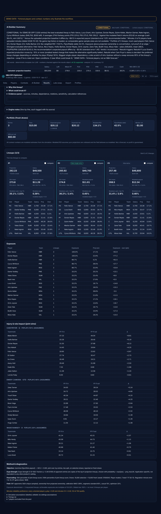
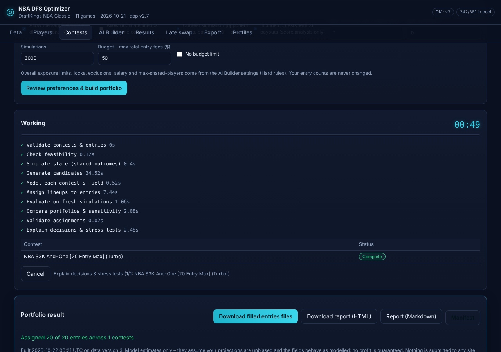
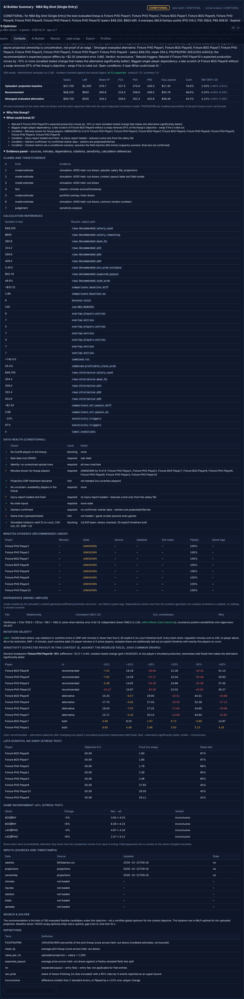
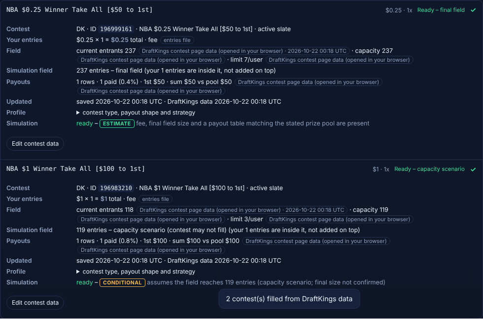
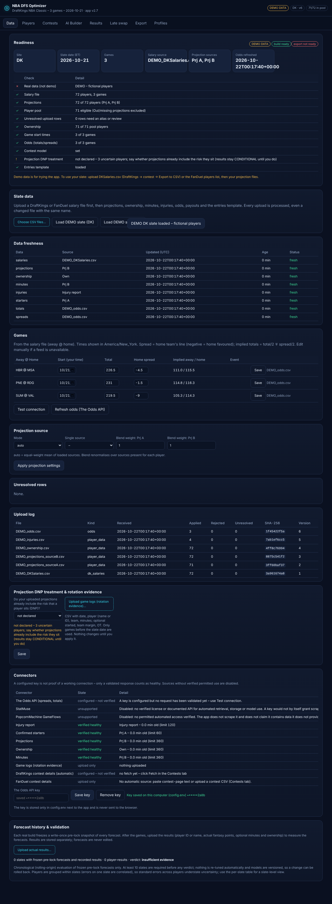

# 🏀 NBA DFS Lineup Optimizer & Contest Simulator (v2.7)

> **Note:** This repository serves as a **portfolio showcase**. To protect intellectual property and proprietary mathematical models, the core source code and optimization engine are kept in a private repository. Live demos or code walkthroughs are available upon request for prospective clients.

---

## 📌 Project Overview
**NBA DFS Optimizer** is a full-stack, production-grade Daily Fantasy Sports (DFS) web application designed specifically for **DraftKings NBA** contests. It combines Linear Programming (LP) optimization, Monte Carlo contest simulations, an AI-assisted strategy builder, and a multi-contest Late-Swap engine into a responsive desktop and mobile interface.

---

## 🚀 Key Features

* **⚡ High-Speed Lineup Optimization Engine:** Generates up to 150+ mathematically optimal lineups in seconds while strictly adhering to DraftKings salary caps ($50,000), multi-position eligibility (PG, SG, SF, PF, C, G, F, UTIL), and team-stacking rules.
* **🎲 Monte Carlo Contest Simulator:** Simulates thousands of tournament outcomes using player projection distributions and ownership estimates to calculate **Win Rate (%)**, **Top 1% / Top 10% Finish Rates**, **Cash Rate**, and **Expected ROI**.
* **🔄 Automated Late-Swap & Multi-Contest Engine:** Parses live DraftKings entry files (`DKEntries.csv`), detects locked players from started games, and dynamically re-optimizes remaining roster spots across multiple contests simultaneously.
* **🤖 AI Strategy Builder:** Analyzes slate dynamics, value tiers, and leverage opportunities to provide automated portfolio construction summaries and exposure recommendations.
* **📤 Direct DraftKings CSV Export & Paste Helper:** Validates all generated rosters against contest capacity and exports 100% upload-ready CSV files with zero formatting errors.
* **📱 Responsive Dark-Mode UI:** Seamless experience across both desktop workstations and mobile devices for on-the-go late swaps before lock.

---

## 🖼️ Application Screenshots

### 1. Optimizer Results & Portfolio Exposure (Desktop)

### 2. Monte Carlo Contest Simulation Analytics

### 3. AI Strategy Builder & Slate Summary

### 4. DraftKings Entry Management & Late-Swap Readiness

### 5. Projections & Player Pool Data Management

---

## 🛠️ Tech Stack & Architecture
* **Backend & Optimization:** Python, Linear Programming / MIP Solvers, NumPy / Pandas (Vectorized Monte Carlo Simulation)
* **Frontend:** Modern Responsive Web UI (HTML5, CSS3, JavaScript)
* **Testing & QA:** End-to-End (E2E) Automated Browser Testing (Playwright) & Unit Test Suite (v2.7 Verified)
* **Deployment:** Cross-platform local execution scripts (`.bat` for Windows, `.command` for macOS) & Web Server Ready

---

## 📬 Contact & Custom Development
Looking for a custom sports analytics tool, DFS optimizer, or automated betting/simulation model? Feel free to reach out via my **Upwork Profile** for custom development inquiries.
